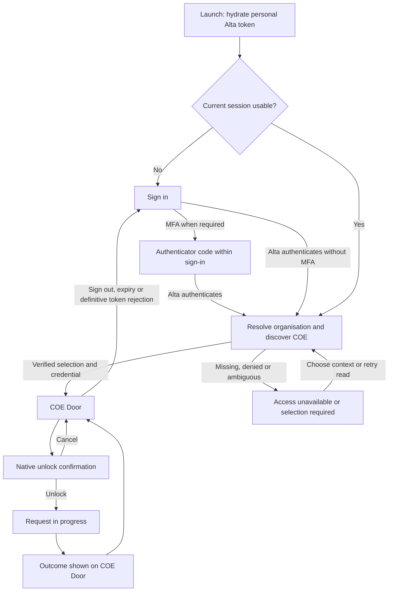

# Latch — IFSS COE Door mobile design

Draft for review · 15 November 2026 · Android first · Documentation only

The primary task is to sign in with an existing **Alta account** and deliberately request an unlock of **COE Door**. Use sign-in (including MFA when required), dynamic discovery and one door screen, with feedback that distinguishes API acknowledgement from physical operation. The [technical specification](technical-design.md) proposes a standalone Android APK calling Openpath directly with the employee's own token, subject to ordinary-user and direct-client compatibility. There is no separate Latch login, backend or Seam integration. Development/testing remain API-only because portal access has been revoked. Implementation waits for design review.

Local development can use dummy users and a simulated door without IFSS access. That demonstration must identify itself visibly; vendor sandbox and IFSS building results require their own evidence. IFSS-operated final acceptance is the proposed handoff, subject to confirming its assessment expectations.

## 1. Observed IFSS branding

I inspected the [IFSS homepage](https://www.ifssgroup.com/home/) visually and read its computed styles and inline font declarations on 15 November 2026. These are website observations, not an official brand manual:

- Black header, white logo, dark photographic sections, and occasional white sections.
- Red `#ED1C20` headings/actions; orange `#F38820` secondary accents; near-white `#F4F4F4` and near-black `#141414` text.
- Bold, often uppercase headings with generous section spacing; rectangular red website buttons.
- Heading/navigation alias **Nm4n Font B** loads **Plus Jakarta Sans**; body alias **Nm4n Font A** loads **Figtree**, confirmed by the site's font-file declarations.

The [header logo](https://www.ifssgroup.com/wp-content/uploads/2023/04/ifss-header-logo-a-sec.png) is an observed asset reference. Obtain approved logo assets and licensed mobile font files before bundling them; do not recreate the logo.

## 2. Mobile adaptation — recommendations

Keep the black brand header, restrained red accents, and typography relationship. Use quiet neutral content surfaces, sentence-case controls, smaller headings, and comfortable touch targets. Avoid carrying the website's large promotional hero into the task flow. Orange is a small brand accent; green and amber communicate outcomes and attention.

Support the system's light/dark preference. Native Android controls, keyboard behaviour, navigation, and feedback should feel like Android. The installed starter declares Expo SDK 58 and already includes `@expo/ui`; its [SDK 58 documentation](https://docs.expo.dev/versions/v58.0.0/sdk/ui/) provides native Android controls. Validate the needed control APIs during implementation rather than adding another UI library.

### Colour roles

All values below are **proposed mobile tokens**, except the explicitly identified website colours. Neutral values are reference targets; prefer matching platform semantic surfaces/text where they preserve legibility and branding.

| Role | Light | Dark | Use |
| --- | --- | --- | --- |
| Brand red — observed | `#ED1C20` | `#ED1C20` | Logo/brand detail; not small white text on red |
| Action red — adapted | `#C9161D` | `#C9161D` | Primary button with white label |
| Action pressed | `#A91319` | `#A91319` | Touch feedback |
| Brand orange — observed | `#F38820` | `#F38820` | Optional small decorative accent |
| Brand header | `#000000` | `#000000` | Approved white logo and light text |
| Screen | `#FFFFFF` | `#141414` | Main background |
| Surface | `#F0F0F3` | `#212225` | Grouped information/input surface |
| Primary text | `#141414` | `#F4F4F4` | Headings and body |
| Secondary text | `#60646C` | `#B0B4BA` | Supporting information |
| Input outline | `#767676` | `#8E8E93` | Identifiable controls |
| Success text / surface | `#166534` / `#F0FDF4` | `#86EFAC` / `#052E16` | Accepted request feedback |
| Attention text / surface | `#92400E` / `#FFFBEB` | `#FDE68A` / `#451A03` | Offline/unknown outcome |
| Error text / surface | `#B91C1C` / `#FEF2F2` | `#FCA5A5` / `#450A0A` | Failure with recovery |

Calculated with the WCAG relative-luminance formula, white on observed red is approximately **4.39:1**, while white on proposed action red is **5.81:1**. The darker action shade supports the [4.5:1 normal-text contrast target](https://www.w3.org/TR/WCAG22/#contrast-minimum). Orange on white is approximately 2.51:1, so it must not carry small text or essential control outlines. These calculations verify selected colour pairs, not a rendered app's accessibility.

### Typography

Propose **Plus Jakarta Sans 600/700** for headings and button labels, and **Figtree 400/500** for body, field labels, and helper text. Bundle only required weights from licensed distributions in the implementation stage. Use the Android system sans-serif fallback if a font cannot load; login must remain usable.

| Named style | Size / line height | Weight | Use |
| --- | --- | --- | --- |
| Screen title | 24 / 32 sp | 700 | Native stack title where supported |
| Door title | 28 / 36 sp | 700 | COE Door |
| Body | 16 / 24 sp | 400 | Instructions and feedback |
| Field / action label | 16 / 24 sp | 500 / 600 | Inputs and buttons |
| Supporting | 14 / 20 sp | 400 | Session identity, timestamps |

These are baseline sizes, not fixed box heights. Respect Android font scaling; let labels wrap and controls grow. Keep critical feedback at body size. Reserve uppercase for a small brand label if needed.

### Layout and component conventions

- Extend the existing `latch_mobile/src/constants/theme.ts` as the single theme source. Preserve its `Colors`, `Fonts`, and `Spacing` conventions; add semantic roles, named text styles, and radii there. Do not create a competing theme folder.
- Use the existing 4 dp rhythm: 8 dp within small groups, 16 dp within forms, 24 dp between groups, 32 dp before a major section. Screen horizontal padding is 24 dp, reducing to 16 dp on narrow screens if needed.
- Main content is one column, capped at 480 dp and centred on wider displays. Use scrolling, keyboard-aware layout, and system-bar insets; never pin the primary button behind the keyboard or navigation bar.
- Inputs and primary buttons have a minimum height of 56 dp and an 8 dp radius. An optional grouped door surface uses a 12 dp radius. Other content uses spacing and separators rather than many raised boxes.
- Every interactive target is at least 48 × 48 dp, following [Android accessibility guidance](https://developer.android.com/guide/topics/ui/accessibility/apps). Use native ripple/pressed feedback. Disabled controls use neutral styling and an adjacent explanation.
- Use Material door, visibility, warning, and check icons with text. A door icon is an identifier, not evidence that the door is locked or open.
- Reuse a button, labelled field, and feedback message only where needed. Button variants: primary, secondary, text; states: default, pressed, disabled, loading. Keep the busy label available to TalkBack when a spinner appears. Keep the door's unique composition local to its screen.
- Use native `@expo/ui` controls where supported, including the confirmation dialog. Standard React Native layout/text inputs are a fallback when a required native control is unavailable or unsuitable. Exact selection is an implementation check, not a new dependency decision now.

## 3. Screens and navigation

### A. Sign in

Top: compact black IFSS brand area with approved logo and **Latch** identity. Content: **Sign in to Latch**. In the approved IFSS environment, helper text is **Use your IFSS-provided Alta account**. In the local demonstration, show **Demo mode — simulated access** and **Use a demo account**, with the provided dummy sign-in choices. Show this distinction before any credential input and on the door screen. A vendor sandbox, if available, is labelled **Sandbox — test environment** rather than IFSS live access. Do not offer separate Latch registration or imply that the development test account is everyone's account.

If a supported delegated sign-in is confirmed, show **Continue with Alta** and use the approved external-browser flow; do not request a password in Latch. Until that is verified, the conditional native-API design uses persistent **Email** and **Password** labels, a show/hide password control, and **Sign in**. This applies to supported Alta-native accounts only; IdP-managed credentials must not be submitted to the native login endpoint. The password passes transiently through the phone directly to the confirmed official API; do not market it as password-free delegated sign-in.

The local form uses in-process mock adapters and dummy data only, without a server. Keep real employee credential collection disabled until ordinary-user compatibility and the approved authentication flow are established. Environment selection belongs to build configuration; there is no in-app toggle that can silently turn a live failure into simulated success. Evaluators should not enter API URLs or numeric organisation, entry or credential IDs.

For accounts requiring MFA, include a labelled **Authenticator code** field in the sign-in flow, supporting one-time-code autofill and numeric entry when appropriate. Reveal it based on confirmed account configuration or a verified provider requirement; do not invent a separate challenge-token exchange. The phone submits the code with the documented login fields directly to Alta. No authenticated session exists until Alta authenticates the user. Code errors remain beside the field; only use specific error copy when the provider actually distinguishes the cause.

Use the email keyboard and normal password-manager/autofill behaviour. Do not autocorrect credentials. Keep the email after failure; never persist passwords or MFA codes. Clear sensitive form state when sign-in completes or is cancelled. Show field-format errors locally and safe provider-derived errors after submission. No password-reset link without a verified Alta reset process. Direct account provisioning/unsupported sign-in issues to IFSS without inventing contact details or requesting portal access.

During submission, show **Signing in…**, disable repeat submission, and retain a stable layout. A network failure preserves the form and offers a manual retry.

### B. Organisation and door discovery

Use the organisation/user associations returned by login. A single unambiguous association proceeds automatically; several require a readable **Choose organisation** step. Show provider organisation names, not numeric-ID input. Signing in does not establish COE permission.

Read this user's permitted entries and match the standalone word **COE** anywhere in the name, case-insensitively. One result proceeds; several require selection by verified site/zone context. If those labels cannot distinguish the candidates, stop and ask the user to contact IFSS. No fuzzy match or first-result fallback is allowed. Show separate neutral states for **No doors returned** and **No COE doors found**, with pull-down refresh. A denied read, invalid response or network failure remains an error. Resolve an existing valid Cloud Key for the same user; ambiguity must not silently select another credential.

### C. COE Door

Native stack header: **Door access** with an accessible **Sign out** action. Main hierarchy:

1. Verified organisation label, with **Change organisation** only where multiple associations exist.
2. The discovered provider name **COE Door** as the dominant live title; **COE Door (simulated)** in the local demonstration. Show verified site/zone context, especially where it distinguished matching doors.
3. Eligibility/configuration message, such as **Ready to request unlock**. Do not label this **Door locked** or **Online** without verified telemetry.
4. One full-width **Unlock COE Door** button.
5. Persistent outcome text directly below the button, with time and an optional copyable support reference.
6. Quiet footer identifying the signed-in Alta user, so shared-device users can check whose access is being used.

Refresh discovery readiness before presenting a native confirmation: **Unlock COE Door?**, with the selected organisation/site/zone context, **Cancel** and **Unlock**. Only the positive action sends the request. If the selection is no longer in the user's current permitted data, disable the action and refresh discovery. The confirmation adds a deliberate step for a physical access action; no long-press gesture is needed.

During the request, keep the door name visible, use **Requesting unlock…**, and prevent another request. Confirmation cancels only before submission. If the user leaves or the app backgrounds after submission, the request may still execute; returning must preserve uncertainty and never resend it automatically.

### Navigation contract

Hold the splash/restoration state until secure token hydration and a current permitted Alta API check resolve. Local session expiry also requires sign-in. On a network failure, show connection recovery with unlock disabled; cached claims are not an access grant. Sign-in/sign-out replace authentication state so Back cannot expose an authenticated screen after sign-out or reopen the login form after success. Android Back from the door screen exits/backgrounds normally; Back dismisses an unsubmitted confirmation. Back never undoes an unlock.

Use the existing Expo Router stack for sign-in, conditional organisation/door selection and the door destination. MFA belongs to sign-in, and unlock outcomes stay on the door screen; neither requires another navigation root. No bottom tabs or general door directory are needed. Login success can lead to an access-unavailable state; it must not imply COE Door permission.

## 4. Required interaction states

| State | Visible feedback | Available action |
| --- | --- | --- |
| Restoring session | Stable splash / “Checking session…” | Wait; connection recovery if needed |
| Local demo | Persistent “Demo mode — simulated access”; dummy account identity | Exercise allowed/denied/expired/revoked fixture cases |
| MFA required | “Enter the code from your authenticator app.” | Submit supported Alta sign-in; cancel |
| Unsupported sign-in / API scope | “This account cannot use the required Alta API. Contact IFSS.”, only when established | Correct sign-in details / IFSS help; no silent fallback |
| Initial door load | Door-layout placeholder and “Checking access…” | Sign out; unlock disabled |
| Multiple organisations / distinguishable COE matches | Readable organisation/site/zone choices | Explicit selection; no numeric IDs or automatic first match |
| Discovery read denied / incomplete | “We couldn't retrieve the access information required for this account.” | Retry when appropriate; IFSS help; unlock disabled |
| Ready | “Ready to request unlock” | Unlock confirmation |
| Missing/unavailable door | “COE Door access is unavailable. Contact IFSS.” | Retry access check; sign out |
| No door entitlement / own Cloud Key missing | “This Alta account cannot unlock COE Door.” with a safe verified reason | Sign out / contact IFSS |
| Alta API unavailable | “Door access is temporarily unavailable.” | Retry access check; sign out |
| Confirmation | Exact door name and consequence | Cancel / Unlock |
| Request pending | “Requesting unlock…” and inline progress | Repeat unlock disabled |
| Successful documented API response | “Unlock request accepted.”; “Door position has not been confirmed.” | Dismiss feedback; deliberate new request after local cooldown |
| Successful simulated response | “Simulated unlock accepted. No physical door was operated.” | Continue demo; label remains visible |
| Explicit rejection | “Unlock request was denied.” or safe, specific operational explanation | Resolve access issue; retry only when appropriate |
| Timeout / lost response / interrupted operation | “We couldn't confirm the result. The door may have unlocked. Check before trying again.” | Acknowledge and check; deliberate new request only |
| Offline | “Connect to the internet to request an unlock.” | Retry connection; unlock disabled |
| Local sign-in cap / provider expiry reached | “Your session expired. Sign in again.” | Clear local token; sign in; never replay previous unlock |
| Alta user token definitively rejected | “Your Alta session is no longer valid. Sign in again.” | Clear this user's token and discovery data; sign in |

API success does not establish door position, relock time, or access duration. Do not animate an opening door, display **Door unlocked**, show a countdown, or claim the door relocked without a separately verified signal. If the selected API later exposes a stronger acknowledgement, revise the copy to match its exact meaning.

Initial loading, failure, a resolved missing door, and usable content are distinct states. A metadata refresh failure can retain the known door name with a warning, while disabling unlock until readiness is rechecked. Readiness is not a cached access grant; each attempt uses this user's authority at Alta. Never show another user's previous result after an account change. An unlock is never queued offline or replayed on login/reconnect/resume. A cooldown does not prove the door relocked.

## 5. Accessibility, feedback, and review criteria

Use text and icons alongside semantic colours. Announce request outcomes once through TalkBack without stealing focus from the primary action. Maintain logical focus order, persistent labels, readable error text, and accessible names for visibility/sign-out controls. Keep the exact door name in the confirmation and button label.

Use native transitions and progress indicators. Do not add decorative motion or make haptics/sound the sole feedback. Respect reduced-motion settings. Before implementation is considered complete, review both colour schemes, a narrow Android phone, large font/display sizes, keyboard-open login, TalkBack, and success/failure/unknown-result recovery on a real APK.

The proposed direction preserves IFSS's recognisable typography, black brand area, and red emphasis while making the door name, action, and outcome easier to read on a phone. This stage contains a written design only: no app screens have been rendered or interaction-tested. Website inspection and selected colour calculations are the evidence available so far.

## 6. Decisions awaiting agreement

- Existing Alta accounts are the user's preferred sign-in. Verify ordinary-user API compatibility, MFA, own Cloud Key, scopes and entry policy with IFSS; portal access is not part of the workflow.
- Confirm that IFSS will perform the final compatibility/building test. Local demo and optional vendor-sandbox testing must not be presented as that result.
- The app is **Latch**. Obtain approved IFSS branding assets for its presentation.
- Confirm whether a request acknowledgement is sufficient for evaluation, or whether IFSS expects observed physical operation/telemetry in the demonstration.
- Review direct mobile authentication and dynamic discovery before implementation. A confirmed compatibility blocker requires a new design decision; separate accounts, a shared Cloud Key, a backend and Seam are not automatic fallbacks.
